# @couryo/email-templates

Templates de e-mail transacional brasileiros para [React Email](https://react.email): Pix, boleto, recuperação de senha, código de login, recibo e mais. Textos em português e inglês, layout de 600 px e parte em texto puro incluída. Funciona com qualquer provedor de e-mail.

[Read in English](README.md)

> **Situação:** versão 0.1.0, ainda não publicada no npm. O comando de instalação abaixo vale quando for publicada; até lá, gere o pacote a partir desta pasta (veja [Como contribuir](#como-contribuir)).

## Templates

| | | |
|---|---|---|
| **Boas-vindas** `welcome`<br>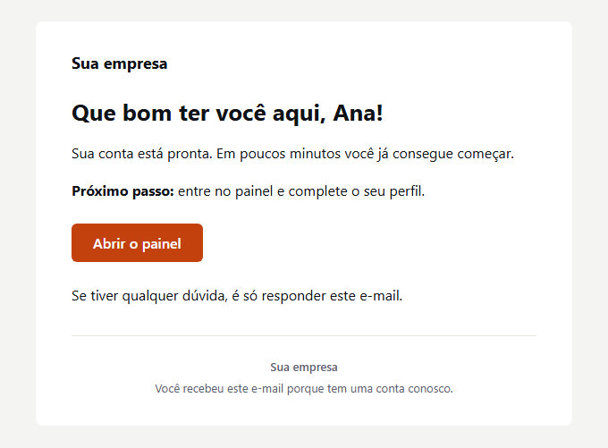 | **Confirmação de e-mail** `email-confirmation`<br>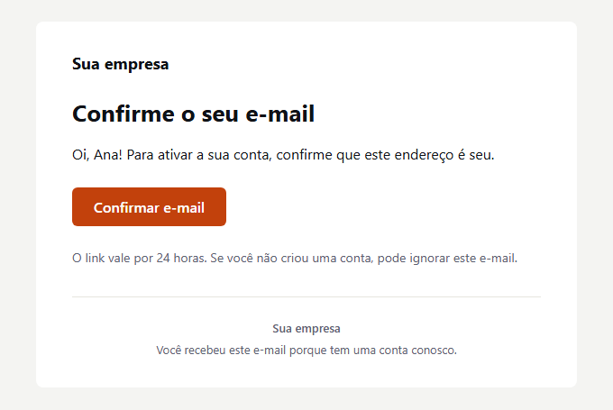 | **Recuperação de senha** `password-reset`<br>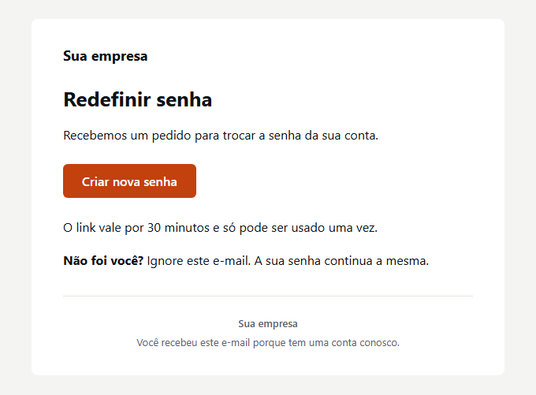 |
| **Código de login (OTP)** `login-code`<br>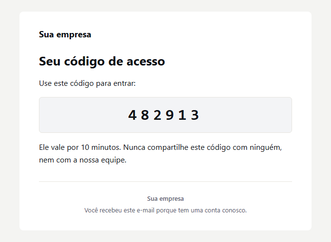 | **Convite de equipe** `team-invite`<br>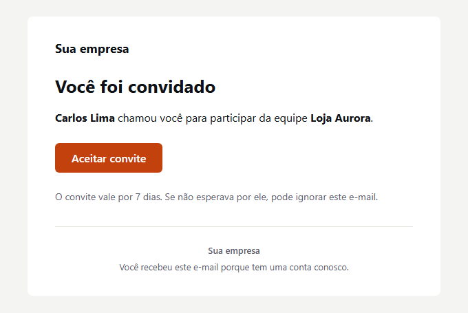 | **Recibo** `receipt`<br>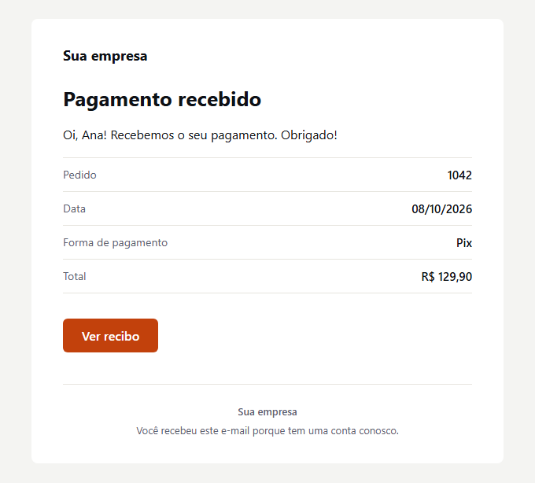 |
| **Cobrança Pix** `pix-charge`<br>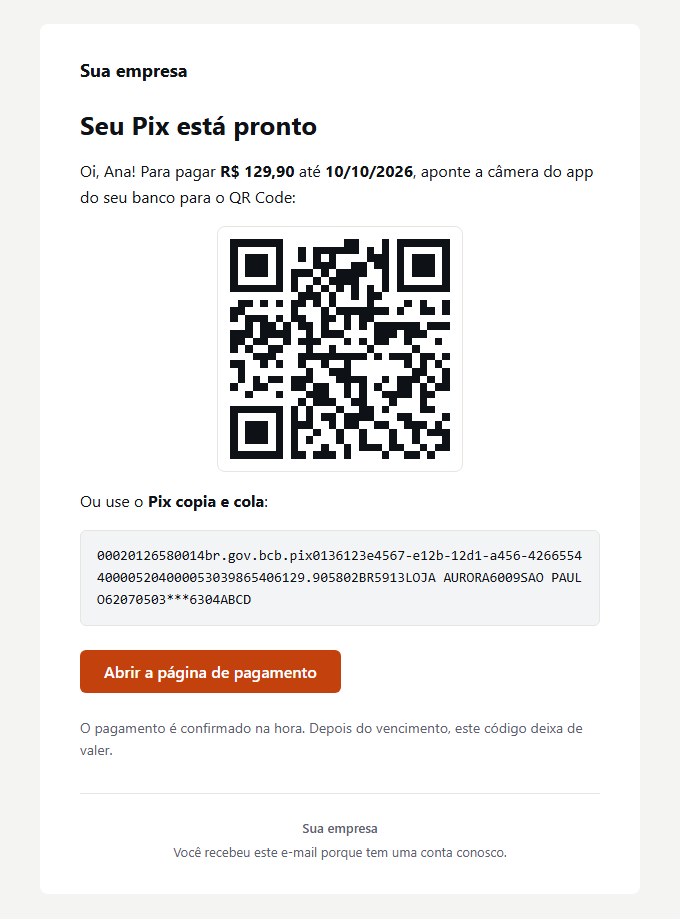 | **Boleto** `boleto`<br>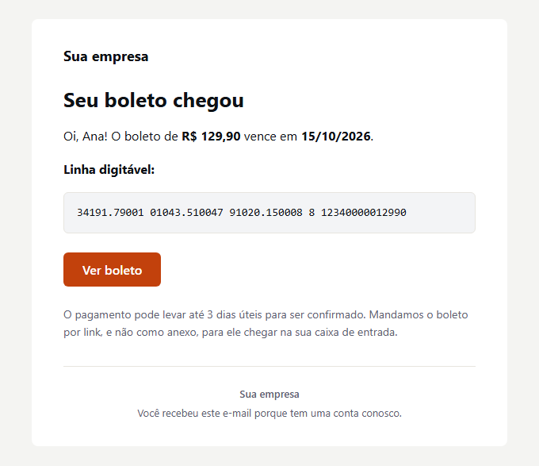 | **Pagamento recusado** `payment-declined`<br>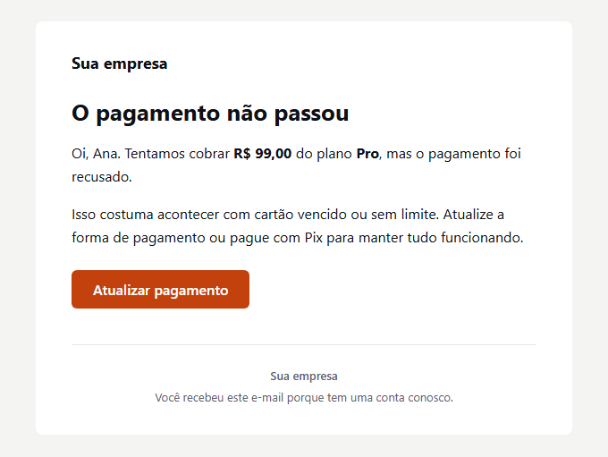 |
| **Assinatura renovada** `subscription-renewed`<br>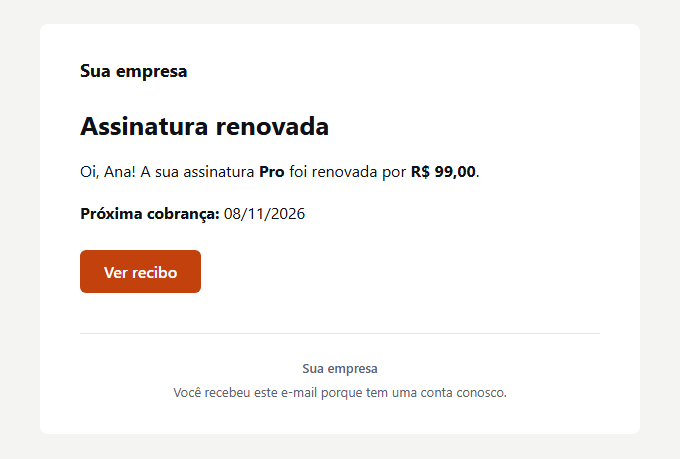 | **Assinatura cancelada** `subscription-canceled`<br>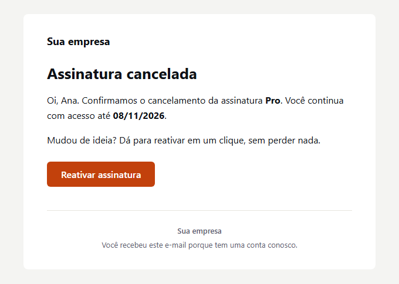 | **Carrinho abandonado** `abandoned-cart` (marketing)<br>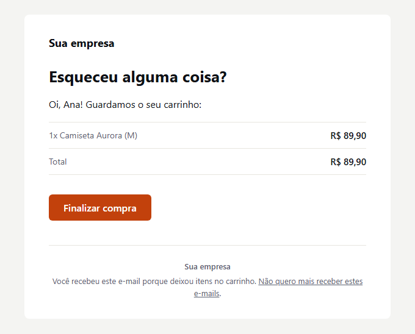 |
| **Pedido enviado** `order-shipped`<br>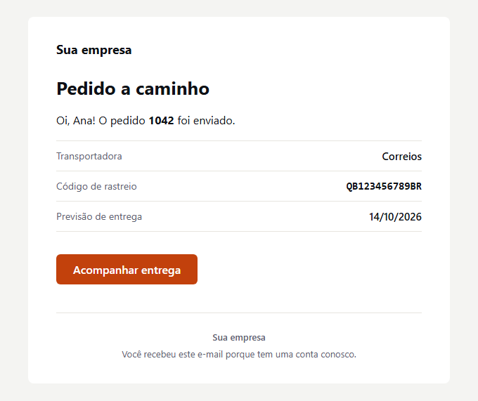 | | |

As prévias mostram a versão em português com as props de exemplo. Todo template também tem versão em inglês (`lang: "en"`).

| Id | Componente | Categoria | Tipo de envio |
|---|---|---|---|
| `welcome` | `Welcome` | conta | transacional |
| `email-confirmation` | `EmailConfirmation` | conta | transacional |
| `password-reset` | `PasswordReset` | conta | transacional |
| `login-code` | `LoginCode` | conta | transacional |
| `team-invite` | `TeamInvite` | conta | transacional |
| `receipt` | `Receipt` | cobrança | transacional |
| `pix-charge` | `PixCharge` | cobrança | transacional |
| `boleto` | `Boleto` | cobrança | transacional |
| `payment-declined` | `PaymentDeclined` | cobrança | transacional |
| `subscription-renewed` | `SubscriptionRenewed` | cobrança | transacional |
| `subscription-canceled` | `SubscriptionCanceled` | cobrança | transacional |
| `abandoned-cart` | `AbandonedCart` | comércio | marketing |
| `order-shipped` | `OrderShipped` | comércio | transacional |

## Instalação

```bash
npm install @couryo/email-templates @react-email/components react
```

`react`, `react-dom` e `@react-email/components` são dependências peer: o seu projeto fica com uma única cópia de cada (a mesma que os seus próprios templates React Email já usam). O npm 7 em diante instala o `react-dom` sozinho; com pnpm ou Yarn, adicione também se ainda não tiver. O `@react-email/render` é dependência normal, usada pelo `renderTemplate`. React 18 ou mais novo.

## Como usar

### Gerar HTML e texto

```ts
import { renderTemplate } from "@couryo/email-templates";

const { subject, html, text } = await renderTemplate("pix-charge", {
  lang: "pt",
  brand: { name: "Loja Aurora", color: "#C2410C" },
  customerName: "Ana",
  amount: "R$ 129,90",
  dueDate: "10/10/2026",
  pixCode: "00020126580014br.gov.bcb.pix...6304ABCD",
  qrCodeUrl: "https://loja-aurora.example/pix/qr/1042.png",
  paymentUrl: "https://loja-aurora.example/pagar/1042",
});
```

`renderTemplate(id, props, { plainText? })` devolve `{ subject, html, text }`. As props são tipadas por template: o editor completa e o TypeScript avisa quando falta alguma. Passe `{ plainText: false }` para pular a parte em texto (vem `text: ""`), mas mandar as duas partes é o melhor padrão.

### Usar os componentes direto

Cada template é um componente React Email comum, então você pode renderizar por conta própria:

```tsx
import { render } from "@react-email/render";
import { Boleto } from "@couryo/email-templates";

const element = (
  <Boleto
    customerName="Ana"
    amount="R$ 129,90"
    dueDate="15/10/2026"
    barcodeLine="34191.79001 01043.510047 91020.150008 8 12340000012990"
    boletoUrl="https://loja-aurora.example/boletos/1042"
  />
);
const html = await render(element);
const text = await render(element, { plainText: true });
```

Também existe a lista `templates` com `{ id, component, subject, category, stream, name, description, previewProps }` de cada template (nome e descrição em `pt` e `en`), útil para montar um seletor ou uma galeria. As peças do layout (`Layout`, `Heading`, `Paragraph`, `Button`, `CodeBox`, `InfoRows`, `Divider`, `Footer`) também são exportadas, se você quiser escrever um e-mail novo com a mesma cara.

## Enviar com qualquer provedor

O resultado é HTML e texto comuns, então vai para qualquer lugar:

- **SMTP com Nodemailer**: [examples/nodemailer-smtp.ts](examples/nodemailer-smtp.ts) (`SMTP_HOST`, `SMTP_PORT`, `SMTP_USER`, `SMTP_PASS`).
- **Qualquer API HTTP com fetch**: [examples/fetch-any-api.ts](examples/fetch-any-api.ts) mostra onde `subject`, `html` e `text` entram num corpo JSON.
- **Couryo**: [examples/couryo.ts](examples/couryo.ts) usa a API REST em `https://api.couryo.com/v1/emails` com `COURYO_API_KEY`. É uma opção entre várias; nada nos templates depende dela.

```ts
// Nodemailer, resumido
await transporter.sendMail({ from, to, subject, html, text });
```

## Props

Todo template aceita:

| Prop | Tipo | Padrão | |
|---|---|---|---|
| `lang` | `"pt" \| "en"` | `"pt"` | Idioma do texto. Coloca `lang="pt-BR"` ou `lang="en"` no HTML. |
| `brand` | `{ name, logoUrl?, color?, address? }` | `{ name: "Sua empresa" }` / `"Your company"` | Nome da empresa no topo e no rodapé, logo opcional (40 px de altura; use PNG ou JPG), cor dos botões e links (padrão `#C2410C`; o texto do botão fica branco ou preto conforme o contraste) e uma linha de endereço. |
| `footerNote` | `string` | por que a pessoa recebeu o e-mail | Troca a linha do rodapé. Aceita `**negrito**`, `` `código` ``, `[link](https://...)` e quebras de linha. |

Valores e datas são **textos já formatados** (`"R$ 129,90"`, `"10/10/2026"`): os templates nunca adivinham moeda, idioma ou fuso horário. Formate onde você tem os dados:

```ts
const amount = new Intl.NumberFormat("pt-BR", { style: "currency", currency: "BRL" }).format(129.9); // "R$ 129,90"
const dueDate = new Intl.DateTimeFormat("pt-BR", { timeZone: "America/Sao_Paulo" }).format(new Date(2026, 9, 10)); // "10/10/2026"
```

O que você passa nas props sempre aparece como texto puro: HTML é escapado e caracteres de marcação ficam como foram digitados. Links aceitam só `https://`, `http://`, `mailto:` e `tel:`.

### Cobrança Pix (`PixCharge`)

| Prop | Obrigatória | |
|---|---|---|
| `amount` | sim | `"R$ 129,90"` |
| `dueDate` | sim | `"10/10/2026"` |
| `pixCode` | sim | O código copia e cola (BR Code) que o seu provedor de pagamento devolve. Aparece numa caixa monoespaçada que seleciona com um toque onde o app de e-mail permite, e também na parte em texto. |
| `qrCodeUrl` | sim | URL absoluta `https` da imagem do QR Code hospedada pelo seu provedor de pagamento. O template nunca gera o QR, então nenhum segredo ou chave de pagamento passa por este código. |
| `paymentUrl` | não | Página de pagamento da mesma cobrança (adiciona um botão). |
| `customerName` | não | Sem nome, fica "Oi, tudo bem!". |

### Boleto (`Boleto`)

| Prop | Obrigatória | |
|---|---|---|
| `amount` | sim | `"R$ 129,90"` |
| `dueDate` | sim | `"15/10/2026"` |
| `barcodeLine` | sim | A linha digitável, numa caixa monoespaçada e na parte em texto. |
| `boletoUrl` | sim | Link para a página ou o PDF do boleto. |
| `customerName` | não | |

Os outros templates seguem o mesmo padrão; veja as props tipadas no editor ou em `src/templates/<id>.tsx`. Cada arquivo também tem `PreviewProps` com valores de exemplo.

### Por que o boleto vai por link

Boleto em PDF anexado é um dos golpes mais comuns no Brasil. Por isso os filtros desconfiam de e-mail inesperado com boleto anexo, e muita gente aprendeu a não abrir. Um link para uma página no seu domínio (ou no do seu provedor de pagamento) evita isso, deixa o e-mail leve, permite atualizar ou cancelar o boleto depois do envio e mostra se ele foi aberto. Por isso estes templates recebem URLs e não têm opção de anexo.

### Carrinho abandonado é marketing

`abandoned-cart` é o único template de marketing. Mande só para quem aceitou receber, passe `unsubscribeUrl` (adiciona o link de descadastro no rodapé) e envie também os cabeçalhos `List-Unsubscribe` e `List-Unsubscribe-Post` pelo seu provedor, para os apps de e-mail mostrarem o botão de descadastro deles.

## Modo escuro e acessibilidade

- Layout claro que funciona em qualquer lugar, com ajustes de modo escuro para apps que suportam `prefers-color-scheme` (e os ganchos do Outlook.com). O QR do Pix fica sobre um fundo branco para continuar legível pela câmera no modo escuro.
- `lang` no elemento `<html>`, `<title>` com o assunto, texto alternativo no logo e no QR, cores de texto que passam no WCAG AA e cor do texto do botão escolhida pelo contraste com a cor da sua marca.
- As tabelas de layout levam `role="presentation"` (o React Email cuida disso) e o conteúdo se ajusta a telas pequenas.

## Servidor de prévia do React Email

Para ver os templates ao vivo com a sua marca, crie um arquivo por template na pasta `emails/` do seu React Email e reexporte o componente; as `PreviewProps` vêm junto:

```tsx
// emails/pix-charge.tsx
import { PixCharge } from "@couryo/email-templates";
export default PixCharge;
```

Depois rode `npx react-email dev`. Num clone deste pacote dá para apontar o servidor direto para o código: `npx react-email dev --dir src/templates`.

## Como contribuir

```bash
pnpm install
pnpm build       # tsc para dist/
pnpm typecheck
pnpm lint
pnpm test        # vitest: renderiza todo template em PT e EN e confere o resultado
pnpm previews    # gera de novo o build e as imagens previews/<id>.png
```

O `pnpm previews` precisa do Chrome, Chromium ou Edge instalado. Ele procura `CHROME_PATH`, depois os caminhos de instalação comuns no Windows e no macOS, depois `google-chrome` ou `chromium` no `PATH`. Usa só a linha de comando do navegador (`--headless=new --dump-dom` para medir a altura, depois `--screenshot`), sem pacotes extras. A prévia do Pix usa uma imagem de QR de mentira desenhada localmente, porque a URL de exemplo não existe.

Regras para mudanças: manter os dois idiomas em sincronia, valores e datas como texto, nada de anexo para documento de pagamento e nenhum código específico de provedor em `src/`. Os testes procuram placeholders esquecidos, `undefined` e algumas strings que nunca podem ir para o pacote.

## Licença

[MIT](LICENSE), Copyright (c) 2026 Wunka.
